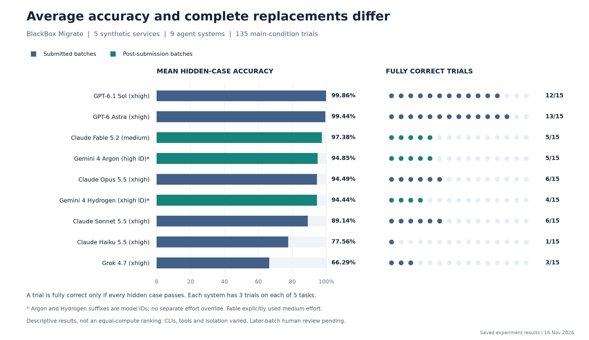
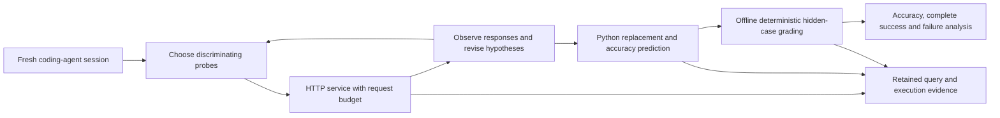

# BlackBox Migrate: coding-agent evaluation for service migration

**An implementation matched all 60 queried examples and still passed only 10.17% of hidden cases.** In the same evaluation, the strongest agent systems averaged above 99%. The useful question is where successful example matching stops being reliable behavior replication.

**5 synthetic services | 9 agent systems | 135 main-condition trials | Deterministic grading, no LLM judge**

This project evaluates whether an AI coding agent can replace an undocumented HTTP business service using a limited request budget. It combines characterization testing, active experimentation, executable code generation and accuracy-prediction analysis.

**Current snapshot: 16 November 2026.** All nine main-condition batches are complete. This repository contains a technical overview and a results figure. **Source code and detailed experimental evidence are available on request.**

## Findings worth inspecting

- **Observed examples can be a poor coverage signal.** Grok's third e-shop implementation matched all 60 successful queries in a saved replay audit, but passed only 42 of 413 hidden cases. It predicted 84% accuracy. Across its full batch, all 810 successful queries matched the final implementations; mean hidden-case accuracy was 66.29%.
- **Near-perfect accuracy and complete replacement are different outcomes.** GPT-6.1 Sol averaged 99.86%, with 12 of 15 fully correct trials. GPT-6 Astra averaged 99.44%, with 13 of 15 fully correct trials. Sol's three parcel trials each passed 417 of 420 cases, repeatedly missing the minimum express-weight charge.
- **The latest extension is strong but still incomplete.** Claude Fable 5.2 at **medium** effort averaged 97.38%, with 5 of 15 fully correct trials and 3.80 minutes of active runtime per trial. Both Fable and Hydrogen passed 417 of 418 payroll cases in every trial, without producing a fully correct payroll replacement.
- **Reducing the query budget changed the outcome.** In a separate, tighter-budget condition, Sol's mean accuracy fell from 99.86% to 95.23%; Astra's fell from 99.44% to 98.63%. This condition was added after the main results and is reported separately.

These are measured outcomes on five synthetic tasks, not a universal ranking of models or an estimate of production failure rates.

## Main-condition results

Each system ran three fresh trials on each of the same five tasks. Mean accuracy weights the 15 task trials equally. A fully correct trial passes every hidden case; matching the agent's own queries is insufficient.

| Agent system and requested setting | Mean accuracy | Fully correct trials | Tasks solved at least once | Tasks solved in all 3 trials |
|---|---:|---:|---:|---:|
| GPT-6.1 Sol, xhigh | 99.86% | 12/15 | 4/5 | 4/5 |
| GPT-6 Astra, xhigh | 99.44% | 13/15 | 5/5 | 3/5 |
| Claude Fable 5.2, medium | 97.38% | 5/15 | 2/5 | 1/5 |
| Gemini 4 Argon, high model ID | 94.85% | 5/15 | 2/5 | 1/5 |
| Claude Opus 5.5, xhigh | 94.49% | 6/15 | 4/5 | 0/5 |
| Gemini 4 Hydrogen, xhigh model ID | 94.44% | 4/15 | 2/5 | 1/5 |
| Claude Sonnet 5.5, xhigh | 89.14% | 6/15 | 3/5 | 1/5 |
| Claude Haiku 5.5, xhigh | 77.56% | 1/15 | 1/5 | 0/5 |
| Grok 4.7, xhigh | 66.29% | 3/15 | 2/5 | 0/5 |

Argon and Hydrogen ran through Antigravity with no separate effort override; their suffixes are part of the requested model IDs. Fable explicitly used medium effort. Collection dates, CLI versions, tools, concurrency and isolation differed. These are **model-plus-CLI comparisons**, not equal-compute experiments. Sorting by mean accuracy does not establish statistical superiority.

## What the agent has to discover

The agent receives an input/output contract, a queryable service and a clear request limit. It chooses probes, infers behavior, writes a Python replacement and predicts its hidden-case percentage accuracy. Source rules and hidden cases are withheld during exploration.

| Synthetic service | Examples of behavior to recover | Main request budget | Hidden cases |
|---|---|---:|---:|
| E-shop pricing | Coupon eligibility, discount bases, shipping exceptions, VAT and rounding | 60 | 413 |
| Parking fees | Grace periods, hourly blocks, caps, validation and overnight rates | 65 | 428 |
| Parcel rates | Volumetric weight, rounding, minimum charges and fee precedence | 60 | 420 |
| Late-payment interest | Date adjustment, grace periods, payment allocation and rate changes | 40 | 415 |
| Weekly payroll | Breaks, overtime, calendar boundaries, premiums and vouchers | 45 | 418 |

Each service has 400 deterministically sampled cases plus explicit boundary and interaction cases. A case passes only when all required outputs match the grader's numeric rules. Candidate execution is offline, with a per-case timeout. The service implementation defines the target behavior, including synthetic policies.

The important distinction is between fitting observations and distinguishing competing rules. A single heavy-parcel price may support either a fixed handling fee or a higher weight rate. Discovering both a free-shipping threshold and a food surcharge does not establish how they interact.

## Engineering behind the experiment

The work started with an e-shop pilot, expanded to four additional domains, and revised easier task versions before the main comparison. It became a micro1 Eval Hackathon submission, followed by three additional agent-system batches.

The retained dataset contains **177 graded trials**: 135 main-condition trials, 30 tighter-budget trials and 12 earlier development trials. A separate 12-run e-shop pilot is outside those totals. Additional model runs do not increase the number of independent tasks.

The implementation covers:

- **Executable evaluation design:** synthetic HTTP services, explicit budgets, deterministic case generation, numeric output checks and reference-execution checks.
- **Failure diagnosis:** 85 predefined mutations across the main tasks, with a greedy fit that connects some incorrect outputs to rule hypotheses and logged probes. The catalog is incomplete and is not a proof of causation.
- **Agent orchestration:** adapters for Claude Code, Codex, Grok and Antigravity; fresh sessions; streamed event capture; recorded model identities and CLI versions.
- **Unattended collection:** process-group cleanup, worker locks, quota-aware stopping, explicit resume, preservation of completed trials and archived failed attempts. Fable completed across three launches with two quota interruptions.
- **Evidence and reporting:** raw events, tool transcripts, queries, delivered implementations, scores and usage metadata; source-hash manifests; staged report generation that checks earlier results remain unchanged. Provider token accounting is kept distinct, and CLI price estimates are not presented as invoices.

This demonstrates evaluation infrastructure, software testing and experimental analysis as one engineering workflow, including the less visible work of recovering interrupted runs and correcting overstated conclusions.

## Runtime and hardware

The reference environment inspected for this snapshot is a Linux x86-64 workstation with an **AMD Ryzen 9 5900X, 12 cores / 24 threads, and about 125 GiB of RAM visible to the container**. The harness uses Python 3.12 in an Ubuntu container, HTTP services and bubblewrap for candidate isolation. The latest Fable wrapper also uses Linux Landlock.

Model inference runs remotely through provider CLIs. Local CPU and memory support orchestration, services, logging and grading; a local GPU is not required by the harness. Provider inference hardware was not measured. Recorded trial durations include agent and service interaction, so they are not hardware throughput benchmarks or guaranteed deployment latencies. This host description is a current observation, not a claim that every historical run had an identical environment.

## Evidence limits and review status

- Five tasks and three repetitions per system provide a small descriptive study. Hundreds of cases within one service are not hundreds of independent tasks. The strongest systems are close to saturation in the main condition.
- Task development and the later tighter-budget condition were adaptive. Reference probes were informed by hidden rules; they do not establish blind human solvability within budget. Reference implementations reuse service logic rather than providing an independent domain oracle.
- Isolation varied across batches. Private process isolation was unavailable in the container; later wrappers used stricter restrictions. Automatic integrity scans flagged some earlier runs. Reviewed Grok outputs did not show hidden-source exposure, but scans and file checks cannot prove absence of leakage.
- The harness allowed 35 minutes of active work even though task text said 30. The discrepancy is retained and disclosed. Quota-interrupted attempts are excluded from capability scores and preserved separately, rather than scored as zero.
- The author reviewed the five task checklists, grading comparisons and representative failures. **Independent human calculations of expected outputs were not performed. Human review of the later Argon, Hydrogen and Fable outputs remains pending.** The synthetic interest and payroll policies are not legal-compliance claims.
- Development and review were AI-assisted. Opus helped construct the suite and was also evaluated, creating a possible authoring bias with unknown direction and magnitude.

## Next experiments, not yet demonstrated

Boundary-focused probe allocation, explicit competing-hypothesis tracking and uncertainty-aware stopping are candidate improvements. A useful next study would compare these strategies under the same request budget, CLI and isolation settings, then add held-out service families. No claim is made that these interventions already improve results.

## Source access and engineering opportunities

**Source code, task definitions, grading logic and detailed experimental evidence are available on request.** This public teaser does not contain the runnable suite or raw logs, so it is not sufficient for independent reproduction by itself.

I developed this project with coding-agent assistance, focusing on testable behavior, retained evidence and reliable experiment execution. I am interested in **AI evaluation, coding-agent infrastructure and research-engineering roles**. For technical discussion, source access or hiring conversations, see my [GitHub profile](https://github.com/spital).

**Technical topics:** LLM evaluation, AI agents, coding agents, black-box testing, characterization testing, legacy migration, active learning, experimental design, mutation testing, hidden-test grading, accuracy calibration, Python, Linux sandboxing, reproducible experiments.

